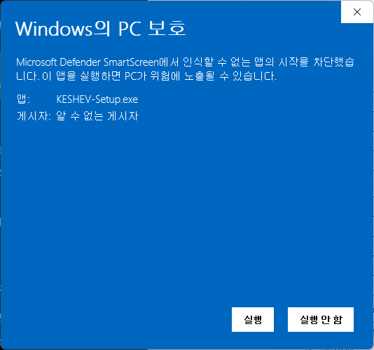
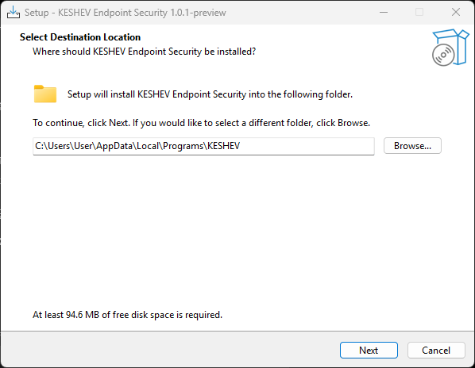
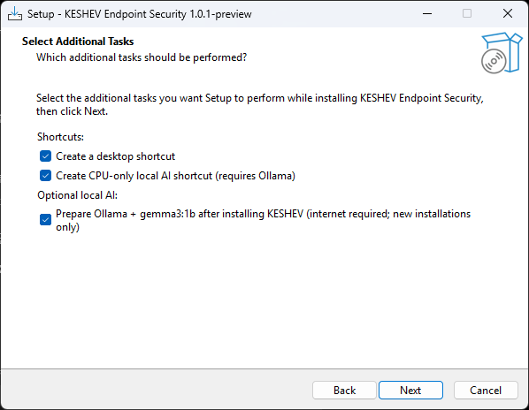
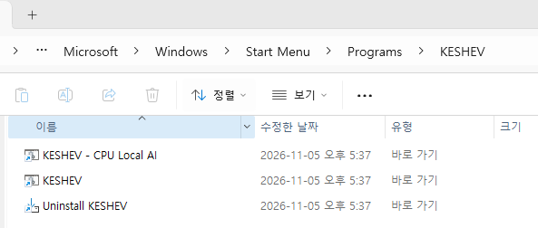

# KESHEV — Windows 설치 및 다른 PC 실행 안내

케셰브(KESHEV)는 Windows PC의 로컬 보안 정보를 수집해 웹 대시보드(`http://127.0.0.1:5190/`)에서 표시하는 프로젝트입니다. Windows Defender 이벤트에 대한 로컬 AI 분석은 선택 기능입니다.

> **EXE 파일이 GitHub에 올라와 있지 않다면** GitHub 소스코드를 내려받아 Windows에서 설치 파일을 직접 빌드해야 합니다. `KESHEV-Setup.exe`를 한 번 만들어 다른 Windows PC로 전달한 뒤에는 설치 대상 PC에서 별도의 빌드가 필요하지 않습니다.

## A. 이미 설치 EXE가 있는 PC에서 사용

1. 신뢰할 수 있는 출처에서 `KESHEV-Setup.exe`를 받습니다. 제공된 SHA-256 값이 있다면 해시를 대조합니다.
2. EXE를 실행해 설치 마법사를 완료합니다. 기본 설치 경로는 `%LOCALAPPDATA%\Programs\KESHEV`입니다.
3. 시작 메뉴에서 **KESHEV**를 실행합니다.
4. 브라우저에서 **http://127.0.0.1:5190/** 를 엽니다.
5. 종료 시 실행 창에서 `Ctrl+C` 또는 설치 폴더의 `Stop-Keshev.cmd`를 사용합니다.

**설치 대상 PC에는 Node.js와 Inno Setup을 별도로 설치할 필요가 없습니다.** 설치 패키지에 Node.js 런타임이 포함됩니다. Windows PowerShell과 Windows 이벤트 로그 기능은 필요합니다. Security 로그 수집은 별도 관리자 권한 승인이 필요할 수 있습니다.

## B. GitHub에 EXE가 없을 때: 설치 EXE 직접 만들기

**빌드 PC 준비물**

- Windows x64, PowerShell, Git
- Node.js **24.19 이상인 24.x 버전**
- [Inno Setup 6 또는 7](https://jrsoftware.org/isdl.php)
- 최초 소스 다운로드와 필요시 Node.js 라이선스 확인을 위한 인터넷 연결

PowerShell에서 GitHub 소스를 복제합니다. **GitHub Download ZIP 대신 `git clone`을 사용하세요.** 기존 빌드 도구는 Git 커밋 확인을 요구합니다.

```powershell
git clone --branch feature/keshev-deployment-profile-v1 https://github.com/stujh00/my-keshev-security-agent.git KESHEV-Source
cd KESHEV-Source
git rev-parse HEAD
```

**ALEPH 제출 당시의 정확한 소스(2026-11-05)** 로 만들려면 다음 명령으로 고정된 커밋을 선택할 수 있습니다. 이 경우 제출 이후 추가된 문서는 작업 트리에서 빠지는 것이 정상입니다.

```powershell
git checkout 43557fa34ea27345e80874c60e582e94491f4755
```

소스 파일을 편집하지 않은 깨끗한 Git 상태에서 기존 빌드 도구를 실행합니다.

```powershell
& '.\on-client\installer\Build-Setup.cmd'
```

빌드 성공 시 `KESHEV-Setup.exe`와 `SETUP-BUILD-REPORT.json`이 아래 형태의 **빌드 PC** 경로에 생성됩니다.

```text
%TEMP%\KESHEV-Setup-Build\<커밋앞8자리>-<빌드시각>\Output\
```

빌드 보고서의 `commit` 값이 의도한 Git SHA와 일치하는지 확인하고, 설치 파일의 SHA-256도 확인합니다.

```powershell
Get-FileHash 'C:\path\to\KESHEV-Setup.exe' -Algorithm SHA256
```

EXE를 설치할 PC로 안전하게 복사한 뒤 위 **A** 절차대로 설치합니다. **EXE 생성 성공과 다른 PC에서의 정상 작동은 별도의 검증 사항입니다.**

## C. 선택 기능: Ollama 로컬 AI

설치 EXE에 **Ollama와 AI 모델은 포함되지 않습니다.** AI 기능이 필요하면 해당 PC에 별도로 설정합니다.

1. [Ollama for Windows](https://ollama.com/download/windows)를 설치합니다.
2. PowerShell에서 `ollama pull gemma3:1b`를 실행하여 모델을 받습니다(약 806MB).
3. 설치 폴더의 `setup-tools\Prepare-Ollama.ps1`을 검토한 뒤 실행하면 Ollama·모델 확인과 `ai-local.json` 설정을 보조할 수 있습니다. 설치 과정에서 선택형 AI 준비 작업을 선택했다면 완료 여부를 먼저 확인하세요.
4. `%LOCALAPPDATA%\KeshevEndpoint\ai-local.json`이 아래 설정을 갖는지 확인합니다.

```json
{
  "enabled": true,
  "model": "gemma3:1b"
}
```

5. 시작 메뉴의 **KESHEV - CPU Local AI** 바로가기로 실행합니다. 바로가기가 없다면 설치 프로그램의 선택 항목에서 추가할 수 있습니다.

CPU 전용 실행기는 포트 `11434`에서 다른 Ollama 서버가 실행 중이면 안전하게 중단할 수 있습니다. 기존 Ollama 작업을 **정상 종료**한 후 다시 시도하세요. 케셰브 자체는 `5190` 포트를 사용합니다. 로컬 AI가 영어로 응답할 수도 있으며, 분석 의견은 검증된 보안 판단이나 자동 조치가 아닙니다.

## D. 실제 확인 상태 및 한계

- **최종 제출 소스 커밋:** `43557fa34ea27345e80874c60e582e94491f4755`
- 해당 커밋에서 Windows 설치 EXE **빌드**, Portable 무결성 확인, **기존 설치가 있던 개발 PC에서 재설치와 웹 UI 실행**을 확인했습니다.
- **완전히 새로운 다른 PC에서의 최초 설치·실행은 아직 검증되지 않았습니다.** 해당 PC의 Windows 버전, 권한 및 보안정책에 따라 별도 점검이 필요합니다.
- 기업용 ZTNA/SDP 중앙 서버는 기본 연결되지 않습니다. 화면의 'ZTNA 서버 미연결'은 연결 실패를 정직하게 표시하는 것입니다.
- Windows SmartScreen은 서명되지 않은 개인 제작 EXE에 경고할 수 있습니다. 조직의 보안정책을 우회하지 마세요.
- 인증정보(`native.json`, `.env`, 인증서·키), 개인 로그 및 측정값을 배포하지 않도록 설계되어 있으나, 공개·공유 전 파일을 다시 검토하세요.
- 프로그램 제거 후 `%LOCALAPPDATA%\KeshevEndpoint`의 로컬 수집 데이터나 설정은 남을 수 있습니다.

추가 설치기 정보: [`on-client/installer/README.md`](on-client/installer/README.md)

**참고:** 이 설치 안내는 최종 제출 이후 작성됐습니다. 문서 추가 커밋이 생기더라도 위 40자리 **기존 제출 커밋은 그대로 보존**됩니다.

---

<!-- KESHEV-WINDOWS-INSTALL-GUIDE-START -->

## Windows 설치 화면 및 프로그램별 역할

최신 설치 파일은 [KESHEV v1.0.1-preview Releases](https://github.com/stujh00/my-keshev-security-agent/releases/tag/v1.0.1-preview)에서 **Assets → KESHEV-Setup.exe**를 다운로드하세요. 소스코드를 직접 빌드할 필요가 없습니다.

### 1. SmartScreen 경고



직접 제작한 미서명 프로그램은 Windows SmartScreen에서 **알 수 없는 게시자** 경고를 표시할 수 있습니다. 이 경고 자체가 악성코드 판정은 아닙니다. 다운로드 출처와 SHA-256을 확인하고 PC 또는 조직의 보안 정책이 허용할 때에만 실행하세요. 보안 정책은 우회하지 마세요.

배포 EXE SHA-256: `11FA2A8ECDE72DBEAECF923B950A45A7F4B0012794ED0108D43586021B24B746`

```powershell
Get-FileHash "$env:USERPROFILE\Downloads\KESHEV-Setup.exe" -Algorithm SHA256
```

### 2. 설치 경로 설정



기본 설치 경로는 `%LOCALAPPDATA%\Programs\KESHEV`입니다. 예: `C:\Users\User\AppData\Local\Programs\KESHEV`. 프로그램 코드와 번들 Node.js 런타임, 실행 스크립트 및 제거 프로그램이 저장됩니다. 특별한 이유가 없다면 기본 경로로 **Next**를 누르세요.

### 3. 추가 작업 선택



| 설치 옵션 | 의미 |
| --- | --- |
| **Create a desktop shortcut** | 바탕화면에 일반 모드 **KESHEV** 실행 바로가기를 만듭니다. |
| **Create CPU-only local AI shortcut (requires Ollama)** | 시작 메뉴에 **KESHEV - CPU Local AI**를 추가합니다. AI용 Ollama가 필요합니다. |
| **Prepare Ollama + gemma3:1b after installing KESHEV** | 새로 설치하는 PC에서 Ollama와 `gemma3:1b` 모델 설치·확인을 돕는 스크립트를 실행합니다. 인터넷이 필요하며, 선택 기능입니다. |

### 4. 설치 후 시작 메뉴 프로그램의 역할



| 시작 메뉴/바탕화면 항목 | 무엇을 하는 프로그램인가? |
| --- | --- |
| **KESHEV** | PC 보안 정보 수집과 대시보드 실행. 브라우저에서 `http://127.0.0.1:5190/` 접속 |
| **KESHEV - CPU Local AI** | Ollama 기반 로컬 AI를 CPU 전용으로 사용하도록 준비하고 KESHEV 실행. 설치 시 해당 옵션 선택 시 생성 |
| **Uninstall KESHEV** | 설치된 KESHEV Endpoint Security 프로그램을 제거하는 공식 제거 프로그램 실행 |
| **KESHEV** (바탕화면) | 시작 메뉴의 KESHEV와 동일한 일반 실행 바로가기. 설치 시 바탕화면 옵션 선택 시 생성 |

**종료:** 실행 중인 콘솔에서 `Ctrl+C` 또는 설치 폴더의 `Stop-Keshev.cmd`를 사용합니다. CPU AI 모드용 중지 스크립트는 `on-client\tools\Stop-Keshev-CPU-AI.cmd`입니다. 일반 모드와 CPU AI 모드를 동시에 실행하면 포트 충돌이 발생할 수 있습니다.

### 5. 설치 후 저장 위치

| 경로 | 저장되는 것 | 삭제 방법 |
| --- | --- | --- |
| `%LOCALAPPDATA%\Programs\KESHEV` | 설치 프로그램 본체 및 번들 실행 환경 | Windows 설정 → 앱 → 설치된 앱 → **KESHEV Endpoint Security → 제거** |
| `%LOCALAPPDATA%\KeshevEndpoint` | PC/보안 측정 기록 및 `ai-local.json` 등 설정 | 공식 제거 후에도 남을 수 있음. 데이터를 영구 삭제하려면 필요한 내용을 백업한 후 해당 폴더를 수동 삭제 |
| `%APPDATA%\Microsoft\Windows\Start Menu\Programs\KESHEV` | 시작 메뉴 바로가기 | 공식 제거 프로그램 실행 시 정리되는 항목 |
| `%TEMP%\KESHEV-Setup-Build\...` | **직접 소스를 빌드한 PC**의 임시 빌드 결과 | 필요하지 않다면 빌드 종료 후 수동 삭제 가능 |
| `Desktop\KESHEV-Source` | **직접 git clone을 한 경우**의 소스코드 | 소스 수정·빌드가 필요 없다면 수동 삭제 가능 |
| `Downloads\KESHEV-Setup.exe` | 다운로드한 설치 EXE | 설치 완료 후 수동 삭제 가능 |

GitHub Releases에서 EXE만 설치했다면 `KESHEV-Source`나 `KESHEV-Setup-Build`가 자동으로 생기지 않습니다. Ollama는 KESHEV와 별개이므로 KESHEV 제거 시 자동 삭제되지 않으며, 모델 저장 경로는 Ollama 설정에 따라 다를 수 있습니다.

### 6. 완전 삭제 및 재설치

1. 실행 중인 KESHEV를 `Ctrl+C` 또는 `Stop-Keshev.cmd`로 종료합니다.
2. **Windows 설정 → 앱 → 설치된 앱 → KESHEV Endpoint Security → 제거**를 사용합니다. 설치 폴더를 먼저 강제로 지우지 마세요.
3. 보안 수집 이력 및 설정까지 지우려면 필요 자료를 백업한 후 `%LOCALAPPDATA%\KeshevEndpoint`를 별도로 삭제합니다. 이 파일은 복구하기 어렵습니다.
4. 소스를 직접 빌드했을 때만 존재하는 `KESHEV-Source`와 `%TEMP%\KESHEV-Setup-Build`도 필요에 따라 삭제합니다.
5. 최신 설치를 위해 GitHub Releases에서 EXE를 다시 다운로드합니다. Git, Node.js, Inno Setup 설치는 필요하지 않습니다. Ollama 로컬 AI는 별도 준비가 필요합니다.

**검증 범위:** Windows 개발 PC에서의 설치·실행은 확인했으나, 완전히 다른 Windows PC에서의 최초 설치 및 모든 보안 기능의 호환성은 아직 별도 검증이 필요합니다. 중앙 ZTNA 서버는 자동 연결되지 않습니다.

<!-- KESHEV-WINDOWS-INSTALL-GUIDE-END -->

