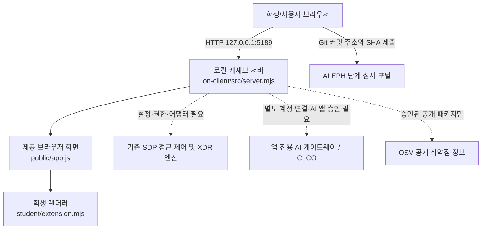

# 케셰브(KESHEV) 학생 실행 설명서 및 시스템 구성도

> 대상: ALEPH 4차 방어전 13~21단계 학생 구현. 이 문서는 제공된 시작 틀 문서를 대체하지 않습니다. 2026-10-27 기준 학생이 보고한 실제 실행·모의 테스트 결과와 저장소 코드를 구분해 기술합니다. **본 문서를 작성했다고 21단계 공식 심사나 실제 보안 시스템 연결이 완료되는 것은 아닙니다.**

## 1. 목적과 지원 범위

케셰브는 사용자의 로그인·기기·세션 상태, 업무 앱 접근 판정, 접속·XDR 기록, AI 연결과 사건 설명, 보안 조치 상태, 공개 패키지 취약점 조회 결과를 보여 주는 로컬 보안 Agent 앱입니다. 정보는 제공 서버와 연결된 시스템이 전달한 범위에서 표시합니다. 화면 출력이 곧 서버의 실제 판정, 보안 조치 집행, AI 모델 호출 또는 취약점 없음의 증명은 아닙니다.

- 학생 화면 구현: `on-client/student/extension.mjs`의 `createStudentView()` 내부 렌더러.
- 제공 코드: `on-client/public/app.js`, `on-client/src/server.mjs`, `on-client/src/` 하위 연결·AI·조치·취약점 처리 코드와 `on-client/tools/`의 실행 도구. **학생 문서 작업에서 변경하지 않습니다.**
- 단계 심사: ALEPH에 제출한 Git 커밋의 원문을 AI가 검토합니다. 새 환경에서 실행했다고 간주하지 않습니다.
- 기본 상태: 기존 SDP/접근 제어·XDR 엔진이 연결되어 있지 않을 수 있습니다. `demo`는 예제일 뿐 실연동이 아닙니다.

## 2. 필수 프로그램과 확인한 버전

| 항목 | 근거 / 상태 |
|---|---|
| Windows PowerShell | 실제 학생 실행에 사용. 정확한 PowerShell 버전은 미측정 |
| Node.js | 학생 PC에서 **v24.21.0** 실행 보고. `on-client/package.json`의 `engines.node` 및 제공 검수 기준은 **24.19.0**. 두 값은 구분하며, 24.19.0에서의 학생 PC 재현은 미확인 |
| npm | `npm ls jsdom happy-dom --depth=0` 실행 확인. npm 세부 버전은 미측정 |
| Git | 커밋·GitHub `main` 푸시 사용 확인. Git 세부 버전은 미측정 |
| 앱 시작 틀 | `on-client/package.json`: `alekov-client-starter` **0.2.14** |
| 외부 npm 의존성 | 시작 틀 README에 외부 npm 의존성이 없다고 설명. 학생 PC에서 `jsdom`, `happy-dom`은 미설치로 확인 |
| 브라우저 | 로컬 URL 접속 화면을 확인함. 정확한 브라우저 버전은 미측정 |

`node -v`, `npm -v`, `git --version`, `$PSVersionTable.PSVersion`으로 사용 중 버전을 확인할 수 있습니다. 실제 출력하지 않은 버전은 추정하지 않습니다. 설치 시 제공 안내 `on-client/docs/STUDENT_LAUNCH_GUIDE.md`를 우선 확인합니다.

## 3. 실제 프로젝트 위치와 파일 구조

학생 PC에서 사용한 경로:

```text
C:\Users\User\AppData\Local\ALEPH\Workbench\projects\케셰브-방어전\    <- Git 최상위
└─ on-client\                                                   <- 앱 실행 위치
   ├─ README.md                                                 <- 제공 문서(보존)
   ├─ package.json                                              <- 실행 스크립트와 기준 버전
   ├─ .env.example                                              <- 비밀값 없는 설정 견본
   ├─ public\app.js                                            <- 제공 브라우저 앱(수정 금지)
   ├─ src\server.mjs                                           <- 제공 로컬 HTTP 서버(수정 금지)
   ├─ student\extension.mjs                                    <- 학생이 단계별로 구현한 화면
   ├─ tools\start-alekov.ps1                                   <- 제공 실행 도구
   ├─ tools\prepare-native-host.ps1                            <- 제공 계정 연결 준비 도구
   └─ docs\
      ├─ STUDENT_LAUNCH_GUIDE.md                                <- 제공 실행 안내
      ├─ CONNECTION_TROUBLESHOOT.md                             <- 제공 연결 장애 안내
      ├─ IMPLEMENTATION_CONTRACT.md                             <- 제공 입력/HTTP 계약
      └─ STUDENT_RUNBOOK.md                                     <- 이 학생 문서(신규)
```

Git 명령은 **프로젝트 최상위**에서, 서버 실행 명령은 **`on-client`**에서 실행합니다. 위 구조는 설명에 필요한 주요 파일만 나열한 것으로 모든 파일을 열거한 것은 아닙니다. `package-lock.json`은 현재 공개 저장소 경로에서 확인되지 않았으므로 존재한다고 가정하거나 새로 생성하지 않습니다.

## 4. PowerShell에서 실행·종료·재실행

1. **새 PowerShell 창**에서 아래 명령어로 앱 폴더에 이동합니다.

   ```powershell
   cd "C:\Users\User\AppData\Local\ALEPH\Workbench\projects\케셰브-방어전\on-client"
   node -v
   npm run check
   ```

   `npm run check`는 `node --check student/extension.mjs`로 **문법만 검사**합니다. 화면과 실제 서버 연결 성공을 검사하지 않습니다.

2. 기본 실행 명령(제공 가이드):

   ```powershell
   powershell -NoProfile -ExecutionPolicy Bypass -File .\tools\start-alekov.ps1
   ```

   단, **이 학생 PC에서는 기본 실행 때 `계정 연결 설정을 확인하지 못했습니다`가 발생한 이력이 있습니다.** 따라서 계정 연결을 시험했던 실제 실행 방식은 아래와 같습니다. 설정 파일 경로만 적으며 내용·자격은 기록하지 않습니다.

   ```powershell
   powershell -NoProfile -ExecutionPolicy Bypass -File .\tools\start-alekov.ps1 -NativeHostConfig "C:\Users\User\AppData\Local\ALEPH\KeshevNativeHost\native.json"
   ```

   위 파일은 기존 실행 과정에서 프로젝트 외부에 별도로 준비한 것입니다. **다른 PC에는 같은 파일이 있다고 가정하지 마세요.** 제공 실행 도구의 자동 준비를 우선 사용하고, 실패하면 `docs/CONNECTION_TROUBLESHOOT.md`를 참조합니다. 설정 내용을 화면·커밋·문서에 복사하지 않습니다.

3. 실행 결과에서 `케셰브 연결 확인: http://127.0.0.1:5189`와 `케셰브가 켜졌습니다`를 확인한 뒤 PC 브라우저에서 **http://127.0.0.1:5189/** 를 엽니다. 시작 메시지는 **로컬 서버가 응답한다는 뜻일 뿐 SDP·AI 연결 완료가 아닙니다.**

4. 종료할 때는 앱을 실행한 PowerShell 창에서 **Ctrl+C**를 누릅니다. 재실행하려면 같은 `on-client` 폴더에서 위 실행 명령을 다시 입력합니다. 다른 프로그램이 포트 5189를 사용 중일 때는 원래 프로그램을 임의 종료하지 않고 제공 가이드에 따른 `-Port 5190` 옵션과 해당 브라우저 주소를 사용합니다.

5. 예제 화면이 필요할 때만 `npm run demo`를 사용합니다. 이 결과는 예제(`demo`)이며 실제 서버 연결 성공이 아닙니다. `-NoNativeHost`는 계정 연결 없이 로컬 화면을 확인하는 옵션으로 실제 계정 승인 점검에는 사용할 수 없습니다.

## 5. 글로 쓴 시스템 구성도



텍스트 설명: 브라우저는 로컬 서버 `http://127.0.0.1:5189/`에 접속합니다. 제공 `public/app.js`가 서버의 API 응답을 받아 `student/extension.mjs`의 렌더러로 상태를 전달합니다. 접근 제어·XDR 연결은 제공 서버가 허용된 어댑터를 통해 처리하며, 기본 실행만으로 실연동되지 않습니다. AI 설명은 별도 앱 권한·게이트웨이가 필요하며, OSV 조회는 담당자가 허용한 공개 패키지 범위에서만 수행됩니다. ALEPH 포털은 앱 서버와는 별개로 제출한 커밋 **원문**을 심사합니다. 점선은 준비되지 않았을 수 있는 외부 연결을 의미합니다.

## 6. 학생 구현 함수와 제공 코드의 경계

| 단계 | 학생 함수 (`createStudentView()`) | 역할 / 주의점 |
|---|---|---|
| 13 | `renderIdentity({me,devices,sessions})` | 로그인·기기·세션 상태 구분. `unknown`을 정상으로 바꾸지 않음 |
| 14 | `renderDecision({status,mode,data,error,appId})` | 업무 앱 접근 허용·거부·추가 확인·미확인·오류 구분 |
| 15 | `renderEvents({status,mode,data,error})` | 접속·XDR 사건, 근거·규칙, 필터와 세부 표시 |
| 16 | `renderStatus({devices,sessions,notifications,diagnostics,mode})` | 알림·장치·세션·진단 및 오류·빈 결과 구분 |
| 17 | `renderAiConnection({status,mode,data,error,checkedAt,explanationAccepted})` | AI 앱 연결 상태 표시. 모델 점검과 사건 설명은 별개 |
| 18 | `renderExplanation({event,explanation,checkedAt})` | 선택 사건 근거 ID와 규칙·unknown 상태를 연결하고 조치 미실행 표시 |
| 19 | `renderAction({status,event,actionId,target,receipt,observation,message,confirmationExpiresAt,error})` | prepared/executing/pending/unknown/succeeded 구분; ACK는 효과 아님, `effectApplied === true` 확인 필요 |
| 20 | `renderVulnerabilities({status,mode,data,error})` | OSV 결과, 정확한 버전, 일부 실패·미조회·취약점 ID 구분 |

학생 코드는 `document.createElement`·`textContent`로 **받은 결과를 표시**합니다. 로그인·접근 판정·이벤트 수집·AI 요청·보안 조치 POST·OSV 외부 조회, 타임아웃·취소 후 늦은 응답 제어는 **제공 코드 영역**입니다. 학생 렌더러에 직접 인증 처리, 실행 버튼, AI 키, 네트워크 호출을 넣지 않습니다.

## 7. 직접 확인한 결과와 미확인 기능

| 범위 | 실제 확인 사실 | 검증 수준 |
|---|---|---|
| 실행 도구 | 명시한 NativeHostConfig로 로컬 5189 서버 시작 메시지와 브라우저 화면 확인 | 학생 PC 실제 실행 |
| 계정 연결 | ALEPH 계정 연결 완료 배너 확인 | 화면 확인; AI 모델 이용 성공과 별개 |
| AI 앱 연결 | 포털 프로젝트 등록·승인 후 로컬에서 `ALEKOV_CONNECT_OUTCOME_UNKNOWN`, `ON_AI_PROVISIONING_PENDING` 관찰 | 실연동 성공 **미확인** |
| 13~16단계 | 이전 단계 공식 통과 결과를 대화에서 보고받음 | 과거 제출 판정 기록; 현 PC 재시험 미실시 |
| 17~18단계 | 문법 검사 및 화면·상태 검토 수행 | 실제 AI 사건 설명 성공 **미확인** |
| 19단계 | `prepared`, `executing`, `pending`, `succeeded(effectApplied true/false)`, `unknown`을 외부 요청 없이 모의 DOM으로 확인. EVENT-A → EVENT-B 교체 시 이전 식별자 제거 확인 | 모의 데이터 테스트; 실제 보안 조치 미실행 |
| 20단계 | `complete`, `partial`, `not_checked`, `not_configured`, `unverifiable` 모의 표시 및 취약점 ID·버전 범위 거부·새 해시 교체 확인 | 모의 데이터 테스트; 실제 OSV 결과 미확인 |
| 패키지 잠금 파일 | 공개 저장소에서 `on-client/package-lock.json`을 확인하지 못함 | 실제 lock 파일과 설치 버전 비교 **미확인** |
| 신규 PC 재현 | 새 폴더·새 PC에서의 실행·권한 설정·실제 엔진 연결 | 미확인(22단계 대상) |

모의 테스트의 `TEST-*` 사건/취약점 ID와 시각은 **가상 입력**이며 실제 사건·CVE/OSV 조회 결과가 아닙니다. 제출 커밋의 AI 판정과 실제 화면 확인 결과를 서로 대신하지 않습니다.

## 8. 문제별 확인·복구 순서

| 증상 / 코드 | 먼저 확인할 사항 | 가능한 다음 조치 |
|---|---|---|
| `앱 폴더가 아닙니다` | PowerShell 현재 경로가 `...\on-client`인지 | `cd`로 실제 앱 폴더에 이동 후 재실행 |
| 포트 5189 사용 중 | 다른 서버가 해당 포트를 점유하는지 | 다른 프로세스를 종료하지 말고 `-Port 5190`으로 실행 |
| `계정 연결 설정을 확인하지 못했습니다` | 기본 자동 Native Host 준비 경로와 오류 메시지 | 기존 파일 삭제·권한 완화 없이 제공 `CONNECTION_TROUBLESHOOT.md` 확인. 이 학생 PC에선 명시적 기존 설정으로 실행한 경험 있음 |
| `NATIVE_HOST_DISABLED` | `-NoNativeHost` 또는 `demo`로 시작했는지 | 실제 연결 확인에는 공식 실행 도구/승인된 설정 사용 |
| `ALEKOV_CONNECT_CONTEXT_CHANGED` | 계정·프로젝트·세션 연속성 | 연결을 성공으로 표시하지 않고 공식 도움정보 및 담당자 지침 확인 |
| `ALEKOV_CONNECT_OUTCOME_UNKNOWN` | 승인 후 연결 결과 확정 여부 | 자동 재시도·무분별한 재발급 없이 담당자에게 상태와 비밀 없는 오류 코드 전달 |
| `ON_AI_PROVISIONING_PENDING` | 앱 전용 AI 이용 권한 준비 여부 | 운영자 확인 필요. 모델 호출·유료 요청 반복하지 않음 |
| `ON_AI_INVALID_INPUT` / `ON_AI_INVALID_OUTPUT` | 사건 근거·규칙·인용 ID 일치 여부 | 근거를 만들지 않고 오류 표시. 기존 사건 목록 유지 |
| 조치 `pending` / `unknown` | 접수 ACK인지 실제 효과 관측인지 | `pending`을 성공으로 표시하지 않음. `unknown`은 연동 시스템 결과만 재조회; 취소는 효과 롤백 아님 |
| OSV `not_configured` / `not_checked` | 승인된 공개 조회 설정과 수행 여부 | 운영자가 허용 대상 준비; 취약점 없음으로 처리하지 않음 |
| OSV `partial` / `unverifiable` | lock 검증/일부 패키지 확인 여부 | 확인된 취약점 ID를 보존; 재조회는 사용자가 제공 화면에서 수행 |

기본 연결 문제는 `docs/CONNECTION_TROUBLESHOOT.md`를, 실행 도구 문제는 `docs/STUDENT_LAUNCH_GUIDE.md`를 먼저 확인합니다. 비밀값이 들어갈 수 있는 설정 파일·환경변수·토큰은 도움정보와 Git 커밋에 포함하지 않습니다.

## 9. 21단계 직접 재현 및 제출 체크

- [ ] 기존 프로젝트를 보존하고 **새 PowerShell 창**에서 `on-client` 폴더로 이동
- [ ] `node -v`, `npm run check` 결과 기록(문법 통과는 기능 통과가 아님)
- [ ] `tools/start-alekov.ps1`의 현재 PC용 실행 방법으로 서버를 켬
- [ ] `http://127.0.0.1:5189/`에서 보호 현황 및 오류/상태 메시지 확인
- [ ] `Ctrl+C` 종료 후 재실행 및 같은 주소 접근 확인
- [ ] 구성도·폴더·버튼명이 최신 프로젝트와 일치하는지 확인
- [ ] `git status --short`로 다른 작업을 검토한 뒤 **이 문서만** 선택하여 커밋
- [ ] 21단계 과제 포털에 **저장소 URL와 새로운 40자리 커밋 SHA를 직접 입력**. GitHub 공개 저장소는 선택형 비공개 원문 JSON이 필요하지 않음
- [ ] 서버 AI 판정 21단계 결과 확인. 통과 여부를 문서만으로 추정하지 않음

이 체크박스는 **작성 시점에 미실행** 상태입니다. 수행한 항목만 직접 체크하고, 실패·미확인 사항은 그대로 남깁니다. 22단계 새 환경 검증은 아직 수행하지 않았습니다.

## 21단계 실제 실행 검증 기록 (2026-10-27)

| 확인 항목 | 결과 |
|---|---|
| Windows PowerShell에서 실행 | 확인 |
| 실제 Node.js 버전 | v24.21.0 |
| 수업 기준 Node.js 버전 | v24.19.0 |
| Native Host 설정 경로를 지정한 서버 시작 | 성공 |
| 로컬 서버 주소 | http://127.0.0.1:5189/ |
| Chrome 브라우저에서 보호 현황 표시 | 확인 |
| Ctrl+C로 서버 종료 | 사용자 확인 |
| 동일 명령으로 서버 재실행 | 성공 |
| 기존 SDP 서버·에이전트 연결 | 미확인 |
| AI 모델 응답 및 실제 보안 조치 | 미확인 |

이번 검증은 로컬 앱의 실행 절차를 확인한 것입니다.
서버가 응답한다는 사실만으로 SDP·AI 연결 또는 보안 조치 성공을 의미하지 않습니다.
